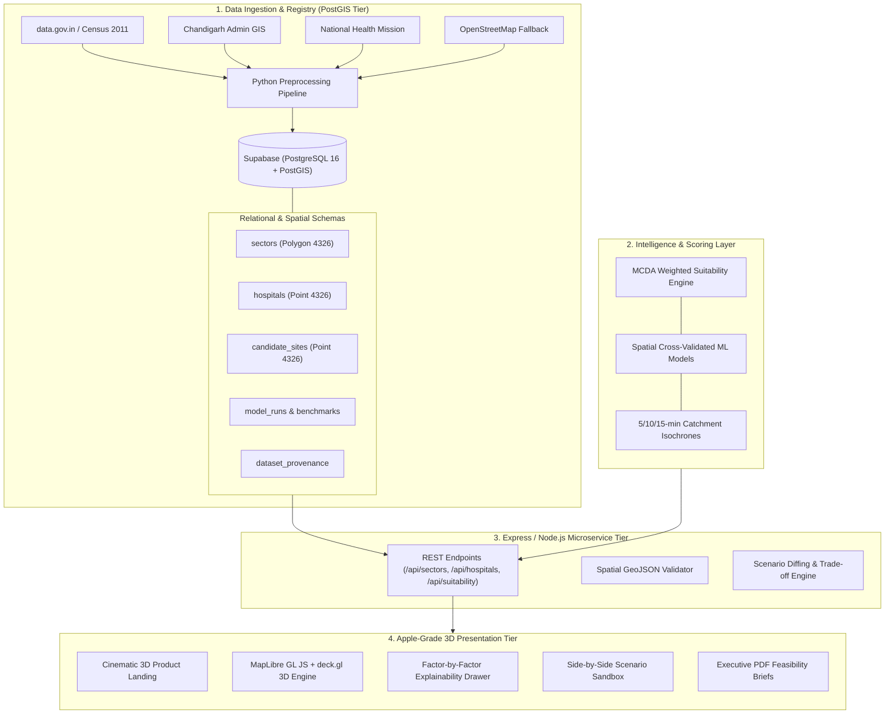

# CityTwin AI — System Architecture Specification

## 1. Executive Architecture Overview

CityTwin AI is a spatial Decision Support System (DSS) engineered to enable urban planners, municipal administrators, and public health authorities to test, evaluate, and compare infrastructure interventions in a high-fidelity virtual digital twin of **Chandigarh, India**, prior to multimillion-crore physical commitment.



---

## 2. Technology Choices & Architectural Rationale

| Layer | Selected Technology | Alternative Rejected | Core Rationale |
| :--- | :--- | :--- | :--- |
| **Database** | **Supabase (PostgreSQL + PostGIS)** | MongoDB | Hospital location planning requires mathematically rigorous spatial topology (`ST_DWithin`, `ST_Distance`, `ST_Contains`, `GIST` indexes). Document stores lack native geodetic math. |
| **3D GIS Mapping** | **MapLibre GL JS + deck.gl** | Leaflet 2D | Leaflet is flat and 2D. MapLibre + deck.gl provides 60fps WebGL rendering of 3D extruded population density towers, sector choropleths, pitch/tilt camera control, and animated isochrone rings with zero paid map token lock-in. |
| **Client Framework** | **React 19 + TypeScript + Vite** | Next.js SSR | Instant client-side responsiveness, rapid spatial parameter recalculation on slider change without round-trip hydration overhead. |
| **Styling & Motion** | **Tailwind CSS v4 + Framer Motion** | Material UI / AntD | Apple Human Interface Guidelines: authentic backdrop-filter glassmorphism, progressive shadows, SF Pro/Inter typography, and fluid spring animations. |
| **Analytics & ML** | **Python (Scikit-learn, SciPy, Pandas)** | Pure JavaScript | Robust scientific computing, spatial cross-validation (grouped by sector to prevent geographic leakage), and reproducible benchmarking. |

---

## 3. Directory & Component Hierarchy

```
AAIPD Project/
├── data/
│   ├── raw/                  # Original, untouched source downloads
│   └── processed/            # Cleaned GeoJSON, JSON, and CSV datasets
├── data_pipeline/
│   ├── generate_chandigarh_base_data.py
│   ├── clean_and_standardize.py
│   ├── spatial_mcda_engine.py
│   ├── train_spatial_models.py
│   └── run_benchmarks.py
├── docs/
│   ├── AUDIT.md              # Codebase audit & gap analysis
│   ├── DECISIONS.md          # Architecture Decision Records (ADRs)
│   ├── DATASETS.md           # Dataset registry with provenance
│   └── screenshots/          # Headless browser visual verification
├── reports/
│   ├── eda/                  # Exploratory Data Analysis & quality reports
│   ├── benchmarks/           # 1,000+ benchmark runs summary
│   └── MODEL_REPORT.md       # ML model evaluation & limitations
├── src/
│   ├── components/
│   │   ├── ExplainabilityPanel.tsx  # Radar & factor contribution drawer
│   │   ├── Navbar.tsx               # Apple glass navigation
│   │   ├── Sidebar.tsx              # Tool and view switching
│   │   └── map/
│   │       └── Chandigarh3DMap.tsx  # MapLibre GL + deck.gl 3D canvas
│   ├── context/
│   │   └── CityContext.tsx          # Global reactive spatial state & weights
│   ├── data/                        # Bundled offline GIS geometries
│   ├── pages/
│   │   ├── Landing.tsx              # Cinematic overview
│   │   ├── Dashboard.tsx            # Main 3D Planning Twin
│   │   ├── Simulation.tsx           # Scenario comparison sandbox
│   │   ├── Analytics.tsx            # Demographic & healthcare telemetry
│   │   ├── Reports.tsx              # Executive feasibility briefs
│   │   ├── Assistant.tsx            # Spatial AI planning copilot
│   │   └── Agents.tsx               # Pipeline orchestrator
│   ├── styles/
│   │   └── tokens.ts                # Apple design tokens
│   ├── types.ts                     # TypeScript data interfaces
│   └── App.tsx
├── supabase/
│   └── migrations/                  # PostGIS schema DDL & RLS rules
└── server/                          # Node/Express API microservice
```

---

## 4. PostGIS Database Schema Overview

```sql
-- Core Chandigarh Sectors Spatial Table
CREATE TABLE sectors (
    id SERIAL PRIMARY KEY,
    sector_name VARCHAR(50) UNIQUE NOT NULL,
    zone VARCHAR(50) NOT NULL,
    population INT NOT NULL,
    area_sqkm NUMERIC(6,3) NOT NULL,
    density_per_sqkm NUMERIC(8,1) NOT NULL,
    land_use VARCHAR(100),
    road_connectivity_score NUMERIC(4,2),
    public_transit_score NUMERIC(4,2),
    geom GEOMETRY(Polygon, 4326) NOT NULL
);
CREATE INDEX idx_sectors_geom ON sectors USING GIST (geom);

-- Existing Healthcare Facilities
CREATE TABLE hospitals (
    id VARCHAR(50) PRIMARY KEY,
    name VARCHAR(150) NOT NULL,
    type VARCHAR(100) NOT NULL,
    sector VARCHAR(50) REFERENCES sectors(sector_name),
    beds INT NOT NULL,
    emergency BOOLEAN DEFAULT TRUE,
    trauma_center BOOLEAN DEFAULT FALSE,
    icu_beds INT DEFAULT 0,
    daily_opd INT DEFAULT 0,
    source VARCHAR(255),
    geom GEOMETRY(Point, 4326) NOT NULL
);
CREATE INDEX idx_hospitals_geom ON hospitals USING GIST (geom);

-- Candidate Hospital Sites
CREATE TABLE candidate_sites (
    id VARCHAR(50) PRIMARY KEY,
    name VARCHAR(150) NOT NULL,
    sector VARCHAR(50),
    vacant_land_acres NUMERIC(5,2) NOT NULL,
    population_within_2km INT NOT NULL,
    distance_to_nearest_hospital_km NUMERIC(5,2),
    road_access VARCHAR(255),
    suitability_score NUMERIC(5,2),
    rank INT,
    recommended_type VARCHAR(150),
    estimated_cost_cr INT,
    rationale TEXT,
    geom GEOMETRY(Point, 4326) NOT NULL
);
CREATE INDEX idx_candidate_sites_geom ON candidate_sites USING GIST (geom);

-- Benchmarking & Validation Store
CREATE TABLE benchmark_results (
    id UUID PRIMARY KEY DEFAULT gen_random_uuid(),
    run_timestamp TIMESTAMPTZ DEFAULT NOW(),
    iteration_number INT NOT NULL,
    weight_configuration JSONB NOT NULL,
    top_candidate_id VARCHAR(50),
    top_candidate_score NUMERIC(5,2),
    mean_score NUMERIC(5,2),
    std_score NUMERIC(5,2),
    execution_time_ms NUMERIC(8,2)
);

CREATE TABLE test_results (
    id UUID PRIMARY KEY DEFAULT gen_random_uuid(),
    component_name VARCHAR(100) NOT NULL,
    test_type VARCHAR(50) NOT NULL, -- unit, integration, edge_case, regression
    test_name VARCHAR(255) NOT NULL,
    status VARCHAR(20) NOT NULL, -- PASS, FAIL
    duration_ms NUMERIC(8,2),
    error_message TEXT,
    executed_at TIMESTAMPTZ DEFAULT NOW()
);
```

---

## 5. Extensibility to Future Facilities and Cities

The platform is designed with modular micro-layers:
1. **New Cities:** To load a new city (e.g., Pune, Bengaluru), provide a GeoJSON polygon collection with administrative boundaries and census demographics. The PostGIS schema handles arbitrary bounding coordinates.
2. **New Facility Types:** To evaluate schools, EV charging plazas, or fire stations, create a new facility registry table and configure the MCDA engine with facility-specific factors (e.g., for EV charging: grid load capacity, traffic density, distance to existing chargers; for schools: population aged 5-18, pedestrian safety index, park proximity).
