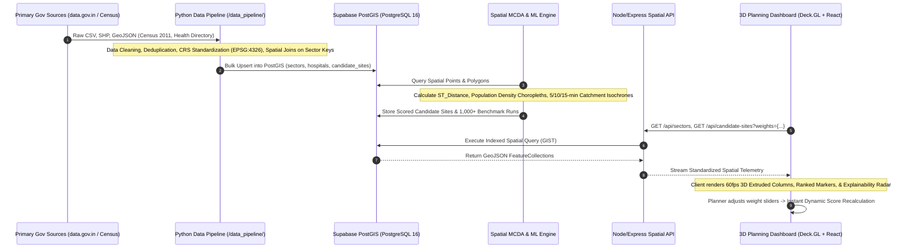
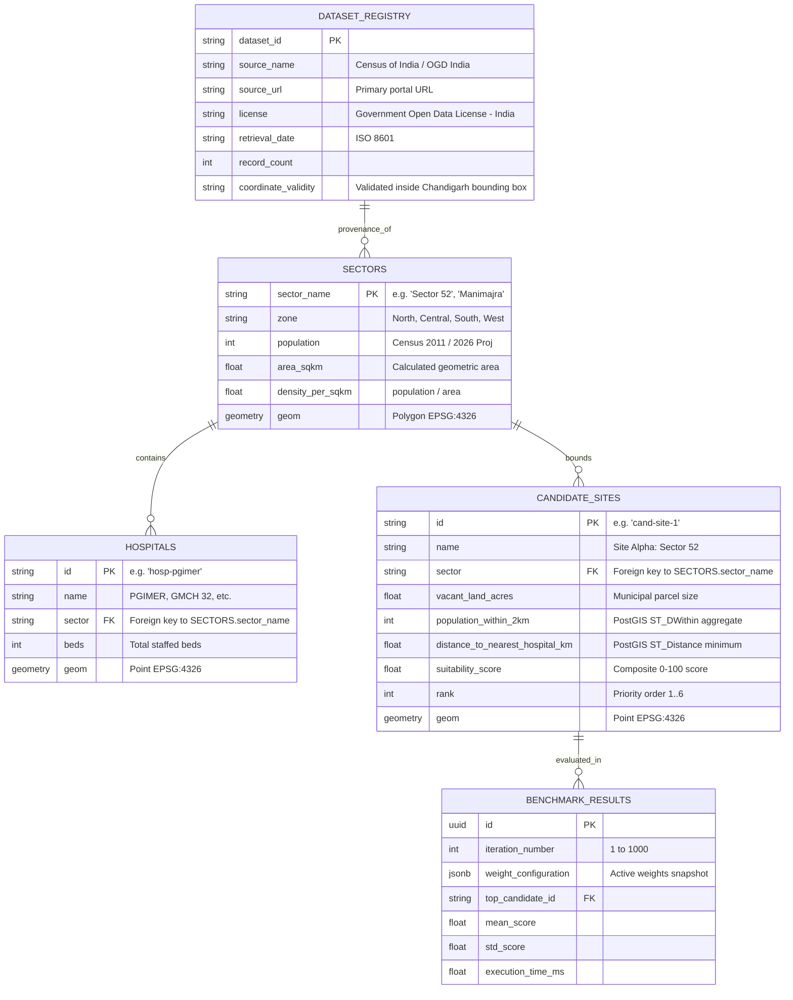

# CityTwin AI — End-to-End Spatial Data Flow

## 1. End-to-End Data Pipeline Architecture

---

## 2. Key Dataset Ingestion & Join Relations

---

## 3. Data Processing & Cleaning Protocol

1. **Raw Ingestion (`/data/raw/`)**:
   - Files are stored in immutable raw formats.
   - Primary sources: Census of India 2011 Village/Town Directory, UT Chandigarh Health Department Official Directory, OGD Platform India.
2. **Quality & Validation Checks**:
   - Coordinate bounding box check: Latitude `30.6800` to `30.7950` N, Longitude `76.7200` to `76.8450` E. All records outside this box are flagged as invalid.
   - Sector Name Standardization: Fuzzy mapping ("Sec 52", "Sector-52", "52 Sector" $\rightarrow$ `"Sector 52"`).
   - Coordinate Reference System (CRS): Standardized strictly to `WGS84 (EPSG:4326)`.
3. **Feature Derivation**:
   - Population density: $\text{Density} = \frac{\text{Population}}{\text{Area}_{\text{sqkm}}}$.
   - Distance to Nearest Hospital: Euclidean and road-corridor distance in kilometers to nearest operational facility with emergency wards.
   - Healthcare Coverage Gap Score: Higher distance to existing hospitals yields higher priority for new facility intervention.
